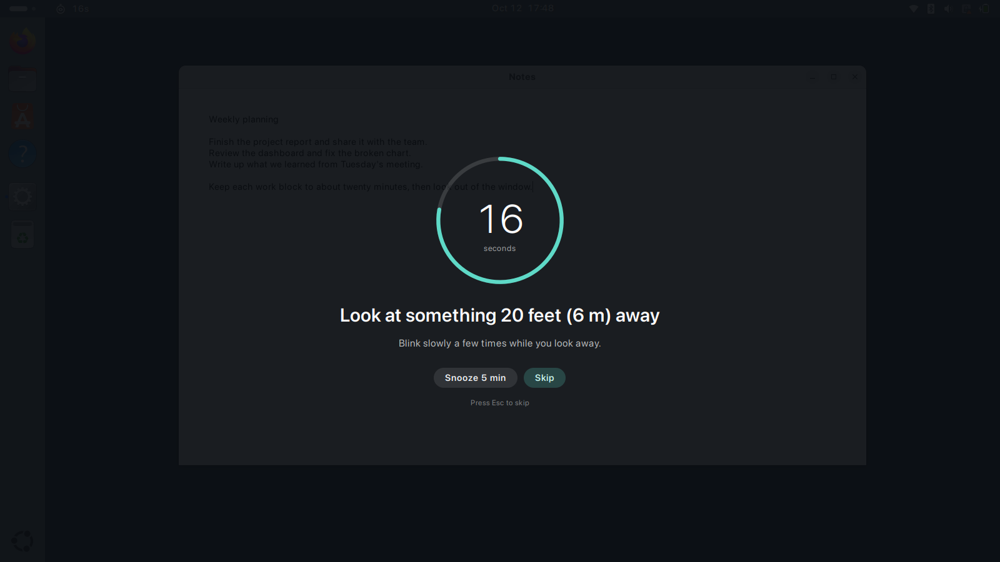
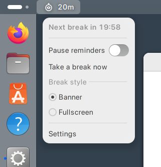
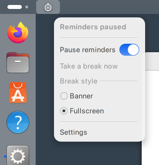
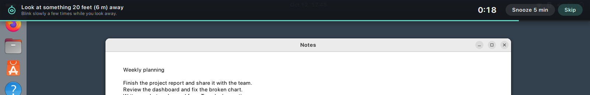
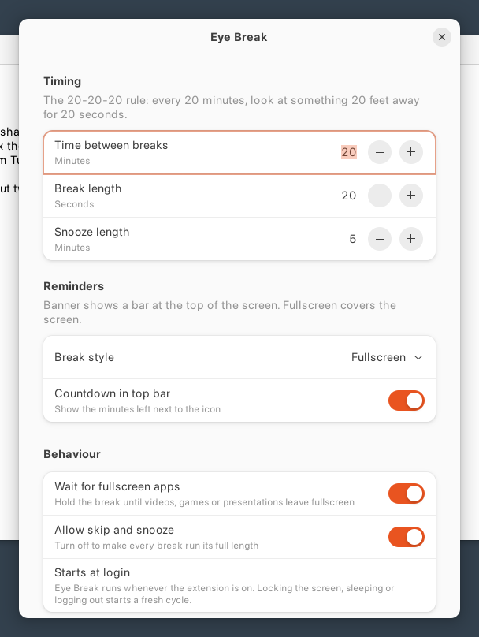
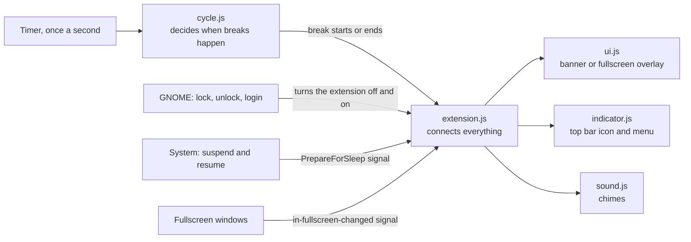
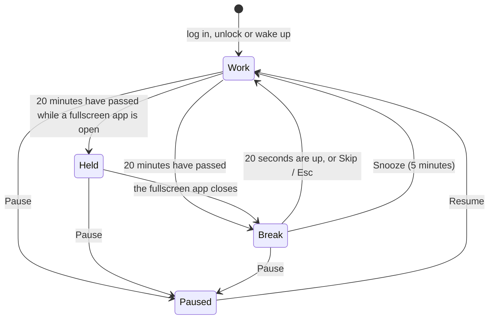

# Eye Break

A small GNOME Shell extension that helps you follow the 20-20-20 rule: every 20 minutes, look at
something 20 feet (about 6 metres) away for 20 seconds.

It stays out of sight while you work. When a break is due, it shows a short reminder with a soft chime,
counts down 20 seconds, and then leaves you alone again.



[](LICENSE)


## Why the 20-20-20 rule?

When you look at something close, like a screen, the small muscles that focus your eyes have to keep
working. We also tend to blink less while reading. After a few hours this can leave your eyes feeling
tired or dry. Looking at something far away for a little while lets those muscles relax, and the
20-20-20 rule is an easy habit that eye-care professionals often recommend for this.

The hard part is remembering to do it, and that's what Eye Break is for.

Please note that Eye Break is only a reminder. If your eyes hurt or your vision changes, please see an
eye doctor.

## What it does

- Runs quietly in the background. Between breaks, the only thing you'll see is a small icon in the
  top bar.
- Offers two ways to show a break: a banner that slides down over the top of the screen while you keep
  working, or a fullscreen reminder that dims the screen for the 20 seconds.
- Starts a fresh 20 minutes after you lock the screen, let it go blank, suspend the computer or log
  out, since that time away has already rested your eyes.
- Waits while a video, game or presentation is fullscreen, and shows the break when you leave
  fullscreen. You can turn this off.
- Lets you pause it from the top bar during meetings or focused work. You can also skip a break, press
  Esc, or snooze it for 5 minutes. If you'd like to be strict with yourself, skipping can be turned off.
- Plays a gentle chime when a break starts and another when it ends. There are three sounds to choose
  from, with a volume control.
- Tries hard to be light: nothing is drawn on screen between breaks, its once-a-second check takes a
  few hundredths of a millisecond, and the whole extension is about 130 KB.
- Respects your privacy. It never connects to the internet and stores nothing except its own settings.

## Installing

Eye Break needs **GNOME Shell 46**, which is what Ubuntu 24.04 LTS uses. I've tested it on GNOME 46
with Wayland. It hasn't been tested on X11 or on other GNOME versions yet.

Eye Break isn't on [extensions.gnome.org](https://extensions.gnome.org) yet. When it is, I'll add a link
here so you can install it with one click. Until then, please use one of the two ways below.

### From the release zip

1. Download `eye-break@saad-rafeque.github.io.shell-extension.zip` from the
   [latest release](https://github.com/saad-rafeque/gnome-eye-break/releases/latest).
2. Install it from a terminal in the folder where you saved it:

   ```bash
   gnome-extensions install --force eye-break@saad-rafeque.github.io.shell-extension.zip
   ```

3. Log out and log back in. GNOME on Wayland only loads new extensions when you log in.
4. Turn Eye Break on in the **Extensions** app, or with:

   ```bash
   gnome-extensions enable eye-break@saad-rafeque.github.io
   ```

### From the source code

```bash
git clone https://github.com/saad-rafeque/gnome-eye-break.git
cd gnome-eye-break
./install.sh
```

The script copies the extension into `~/.local/share/gnome-shell/extensions`, sets up its settings and
turns it on for your next login. It doesn't need `sudo`. After that, log out and log back in.

To update later, run `git pull` and then `./install.sh` again.

Once you're logged in, you'll find the Eye Break icon, a small stopwatch with an eye in it, on the left
side of the top bar.

## Using Eye Break

Click the icon to open its menu:



- **Next break in …** shows how long you have until the next break.
- **Pause reminders** stops the timer. When you switch it off again, you get a fresh 20 minutes.
- **Take a break now** starts a break straight away.
- **Banner** and **Fullscreen** choose how breaks are shown.
- **Settings** opens the settings window.

While Eye Break is paused, the eye in the icon changes to two pause bars:



### When a break starts

In **banner** mode, a bar slides down over the top of the screen with the countdown. The thin line
along its bottom edge shrinks as the seconds pass. Your windows stay usable underneath:



In **fullscreen** mode, every monitor is dimmed and a countdown ring appears, as in the picture at the
top of this page. Clicks don't reach your windows during these 20 seconds, which makes it a little
easier to actually look away.

Either way:

- **Skip** ends the break and starts a fresh 20 minutes. In fullscreen mode, **Esc** does the same.
- **Snooze 5 min** puts the break off for 5 minutes.
- A falling chime plays when the break starts, and a rising one when it's over.

## Settings

You can open the settings from the menu or from the **Extensions** app.



| Setting | Default | What it does |
| --- | --- | --- |
| Time between breaks | 20 minutes | How long you work before each break (1 to 120 minutes). |
| Break length | 20 seconds | How long each break lasts (5 to 300 seconds). |
| Snooze length | 5 minutes | How long **Snooze** puts a break off (1 to 30 minutes). |
| Break style | Banner | Banner or Fullscreen. |
| Countdown in top bar | Off | Shows the time left next to the icon, for example `14m`. |
| Wait for fullscreen apps | On | Holds a break while a fullscreen app is open. |
| Allow skip and snooze | On | When off, breaks always run their full length and **Esc** is ignored. |
| Chimes | On | Plays a sound when a break starts and ends. |
| Chime sound | Soft bell | Soft bell, Wood block or Glass. The ▶ button plays a preview. |
| Volume | 60% | How loud the chimes are. |

If you prefer the terminal, the same settings are available through `gsettings`:

```bash
gsettings --schemadir ~/.local/share/gnome-shell/extensions/eye-break@saad-rafeque.github.io/schemas \
    set org.gnome.shell.extensions.eyebreak break-mode fullscreen
```

## How it works

This part is for anyone curious about what happens behind the scenes, or thinking of contributing.

### The overall design

Eye Break is a GNOME Shell extension, written in JavaScript (GJS). It runs inside GNOME Shell, which is
the program that draws the desktop itself. That's what allows it to show a banner or overlay on top of
every window. On Wayland, an ordinary app isn't allowed to do that.



| File | What it's responsible for |
| --- | --- |
| `extension/cycle.js` | The timer logic. It's plain JavaScript with no GNOME parts, which keeps it easy to test. |
| `extension/extension.js` | Connects the settings, system signals, timer and break screens. |
| `extension/ui.js` | The banner and the fullscreen overlay. |
| `extension/indicator.js` | The top bar icon and its menu. |
| `extension/sound.js` | Playing the chimes. |
| `extension/prefs.js` | The settings window, built with GTK 4 and libadwaita. |

### The timer

The timer is always in one of four states:



Every time it goes back to **Work** after a break, a skip, a resume or a wake-up, you get a full
20 minutes, except after Snooze, which gives you 5.

Times are measured with the system's *monotonic* clock, which always moves forward. Changing the
clock or the time zone won't confuse the timer.

### Noticing when you're away from the screen

| What happens | How Eye Break notices | What it does |
| --- | --- | --- |
| You lock the screen, or it goes blank | GNOME turns extensions like this one off while the lock screen is showing, and back on afterwards | Starts a fresh 20 minutes when you return |
| You log out or restart | The extension starts again when you log in | Starts a fresh 20 minutes |
| The computer suspends | The system (logind) sends a `PrepareForSleep` signal before sleeping and again after waking | Pauses before sleep, then starts a fresh 20 minutes on waking |
| That signal goes missing | Once a second, Eye Break compares the wall clock with the monotonic clock. The monotonic clock stops during suspend, so a gap of more than 30 seconds means the computer was asleep | Starts a fresh 20 minutes |

As an extra safeguard, a pause caused by sleep clears itself after one minute of awake time, so the
timer can't get stuck.

### Fullscreen apps

GNOME tells extensions whenever a window enters or leaves fullscreen. If **Wait for fullscreen apps**
is on and a break comes due during a film or a game, the timer moves to the **Held** state. The break
starts as soon as you leave fullscreen.

### Showing a break safely

- The **banner** sits in GNOME Shell's top layer, above your windows and the top bar. It doesn't
  capture the keyboard or mouse, so you can carry on typing.
- The **fullscreen overlay** covers every monitor and captures the keyboard and mouse, the same way
  GNOME's own dialogs do. That's what lets **Esc** work and stops clicks from reaching your windows.
  It captures input only after everything else is ready, and releases it before anything else when
  the break ends.
- As a safety net, each break screen removes itself 5 seconds after its break should have ended,
  even if something has gone wrong with the timer. Your screen can't stay covered.
- During a break, the countdown and the progress bar or ring are worked out from the clock ten times a
  second. The numbers never skip and the bar never drifts.

### The chimes

The chimes are generated by `tools/make_chimes.py` from a few simple sine waves, so no third-party
sounds are involved. They play through `pw-play` (PipeWire), or `paplay` (PulseAudio) if that isn't
available, because both can set the volume. If neither is installed, Eye Break falls back to GNOME's
own sound player.

### Keeping it light

- Between breaks, Eye Break draws nothing at all. The top bar icon is the only thing on screen.
- The once-a-second check takes a few hundredths of a millisecond. It uses
  `GLib.timeout_add_seconds`, which lets the system group it with other wake-ups.
- Labels and menu items are only updated when their text actually changes, so GNOME doesn't redo the
  layout without a reason.
- During a break, the redraws only touch the countdown and the progress bar or ring, and only for those
  20 seconds.
- The whole extension is about 130 KB, and most of that is the chime sounds.

### Privacy

Eye Break doesn't connect to the internet, doesn't collect anything, and stores nothing except its own
settings in GNOME's usual settings database (dconf).

## Troubleshooting

**I installed it, but I can't see the icon.**
Please log out and log back in first, because GNOME on Wayland only loads new extensions at login. Then
check whether it's running:

```bash
gnome-extensions info eye-break@saad-rafeque.github.io
```

`State: ACTIVE` means it's running. If you see `ERROR` or `OUT OF DATE`, check your GNOME version with
`gnome-shell --version`. Eye Break currently needs GNOME 46.

**Something isn't working right. Where can I find the logs?**

```bash
journalctl --user -b /usr/bin/gnome-shell | grep -i "eye break"
```

If you [open an issue](https://github.com/saad-rafeque/gnome-eye-break/issues), including this output
helps a lot.

**I can't hear the chimes.**
Please check that **Chimes** is on and the volume isn't at zero, then try the ▶ button in Settings.
Eye Break plays sounds with `pw-play`, which comes with PipeWire (standard on Ubuntu 22.10 and later),
or with `paplay`.

**The break didn't appear while I was watching a video.**
That's the **Wait for fullscreen apps** setting. The break will show once you leave fullscreen. If you'd
rather be reminded anyway, you can turn the setting off.

**The timer keeps going back to 20 minutes.**
That's intentional. Locking the screen, a blank screen, suspending and logging in all count as rest,
so each of them starts a fresh cycle.

## Uninstalling

You can remove Eye Break from the **Extensions** app, or with:

```bash
gnome-extensions uninstall eye-break@saad-rafeque.github.io
```

If you installed from the source code, `./install.sh --uninstall` works as well. To also clear your
Eye Break settings:

```bash
dconf reset -f /org/gnome/shell/extensions/eyebreak/
```

## Development

```
extension/          the extension itself (this folder is what gets installed)
  extension.js      connects settings, signals, the timer and the break screens
  cycle.js          the timer logic
  ui.js             banner and fullscreen overlay
  indicator.js      top bar icon and menu
  sound.js          chimes
  prefs.js          settings window
  schemas/          settings schema
  icons/, sounds/   images and sounds
tests/
  cycle.test.js     unit tests for the timer
  e2e.js            end-to-end tests (run through run-e2e.sh)
  run-e2e.sh        starts a private, headless GNOME Shell and runs the tests in it
tools/
  pack.sh           builds the zip for extensions.gnome.org and releases
  make_chimes.py    regenerates the chime sounds
  screenshots.js    retakes the screenshots in this README
install.sh          installs from the source code
```

### Running the tests

The unit tests are quick and only need `gjs`:

```bash
gjs -m tests/cycle.test.js
```

The end-to-end tests start a private, headless copy of GNOME Shell with its own settings, display and
D-Bus session, so your own desktop isn't affected. They drive Eye Break with virtual mouse clicks and
key presses. They check:

- that breaks start and end on time
- Skip, Snooze and Esc
- pausing
- locking and unlocking
- sleep
- fullscreen apps
- changing settings while it runs
- leaks, by opening 40 breaks in a row and switching the extension off and on 25 times
- the settings window and the chimes
- how much CPU and redrawing it causes

They need GNOME Shell 46, a systemd user session and PipeWire, and take about five minutes:

```bash
tests/run-e2e.sh /tmp/eyebreak-e2e        # one monitor
tests/run-e2e.sh /tmp/eyebreak-e2e-2 2    # two monitors
E2E_QUICK=1 tests/run-e2e.sh /tmp/x       # skip the slower CPU measurements
```

Every process the tests start runs in its own systemd scope and is stopped when they finish.

### Other useful commands

```bash
tools/pack.sh                    # builds dist/eye-break@saad-rafeque.github.io.shell-extension.zip
python3 tools/make_chimes.py     # regenerates the chimes (needs ffmpeg with libvorbis)
E2E_DRIVER=tools/screenshots.js tests/run-e2e.sh /tmp/shots   # retakes the README screenshots
```

To try out a change on your own desktop, run `./install.sh`, then log out and log back in.

## Contributing

Bug reports, ideas and pull requests are all very welcome. A few requests:

1. For anything bigger than a small fix, please open an
   [issue](https://github.com/saad-rafeque/gnome-eye-break/issues) first so we can talk it through.
2. Please keep Eye Break light. It should stay invisible between breaks and cost almost nothing to run.
3. Please run the unit tests and the end-to-end tests before sending a pull request.

Help would be especially appreciated with:

- **Newer GNOME versions (47, 48, 49 …).** So far Eye Break has only been tested on GNOME 46. If you
  use a newer version, trying it and letting me know what breaks would be a big help.
- **Translations** into other languages.

Thank you for taking the time to help.

## Credits and license

I wanted something like **Project Irist**, a 20-20-20 app for Windows by Chickadee Labs, on my Ubuntu
desktop, and that's how Eye Break started. It's an independent project with no connection to Chickadee
Labs.

Copyright © 2026 Saad Rafique. Eye Break is free software, released under the
[GNU General Public License, version 2 or (at your option) any later version](LICENSE).
